# OBS Deck

OBS Studio on the Ajazz AKP03E (and other Stream Dock devices): knobs for every audio track with live meters, stream and record keys with on-air frames, scenes with tally, virtual camera, replay buffer and more.

It talks to the WebSocket server built into OBS 28 and newer and follows OBS events, so the keys stay right even when you click things in OBS itself. If OBS closes, the keys turn grey and the plugin reconnects on its own.

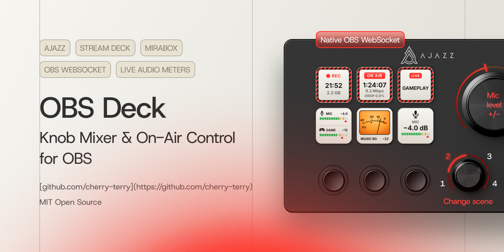

## Contents

- [Features](#features)
- [Install](#install)
- [Connect to OBS](#connect-to-obs)
- [Actions](#actions)
- [Key states](#key-states)
- [Presets](#presets)
- [Troubleshooting](#troubleshooting)
- [Requirements](#requirements)

## Features

- 🎚️ **Volume on the knobs** for any OBS audio input: turn to change (1 to 5 dB a step), press to mute. Turning up unmutes.
- 🔀 **Track Switcher**: one knob picks the input, another knob or key set to *Follow Track Switcher* controls it. Dots on the key show where you are in the list.
- 📊 **Live levels**: bar meters with a red fader mark, or an analog VU meter with a needle.
- 🎛️ **Duo Meter**: two inputs on one key, for example mic and game. The row lights up while its knob turns.
- 🔴 **On-air frames**: hazard tape around Stream, Record, the live scene and a muted mic, yellow while paused or starting.
- 🎬 **Scenes with tally**: LIVE for the program scene, NEXT for the preview in Studio Mode. Up to 4 scenes on one key, or pick any scene with a knob.
- 🛡️ **No accidental stops**: stopping the stream or the recording needs a half-second hold.
- 🔌 **Self-healing connection**: grey keys while OBS is closed, back to normal within 3 seconds after it starts.

## Install

1. Download `com.diy.obs.sdPlugin` from the [releases](../../releases) (or clone this repository).
2. Copy the `com.diy.obs.sdPlugin` folder to `%APPDATA%\HotSpot\StreamDock\plugins`.
3. Restart Stream Dock. The actions appear in the **OBS Deck** category.

## Connect to OBS

1. In OBS open **Tools > WebSocket Server Settings** and tick **Enable WebSocket server**.
2. Press **Show Connect Info** to see the port and the password.
3. Put any OBS Deck action on a key and open its settings. The **OBS connection** panel opens on its own while the plugin is not connected.
4. Fill in the address `127.0.0.1` (or the IP of your streaming PC), port `4455` and the password, then press **Save and connect**. The dot turns green.

All keys share this one connection, so you do it once. The lists of inputs, scenes and sources in the settings come straight from OBS and update when you add something there.

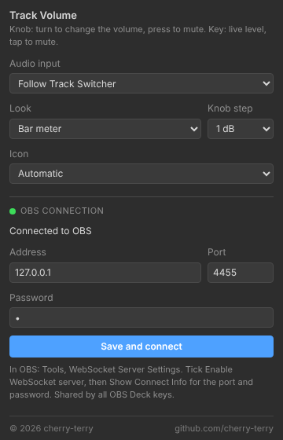

## Actions

Tap means a short press. Hold means half a second or longer.

### Audio

| Key | Action | What it does | Settings |
|:---:|---|---|---|
| 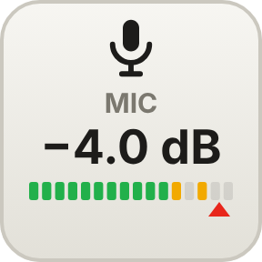 | **Track Volume** key and knob | **Knob:** turn changes the volume, press mutes. **Key:** shows the live level and the volume, tap mutes. | *Audio input*: any OBS input with audio, *First audio input* (default) or *Follow Track Switcher*. *Look*: bar meter or analog VU. *Knob step*: 1, 2, 3 or 5 dB. *Icon*: auto or pick one. |
| 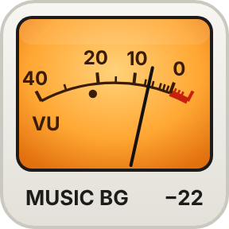 | **Track Volume**, VU look | The same action with *Look: Analog VU meter*. The needle shows the level (0 VU = -18 dBFS), the dot shows the fader. The backlight goes off when muted. | |
| 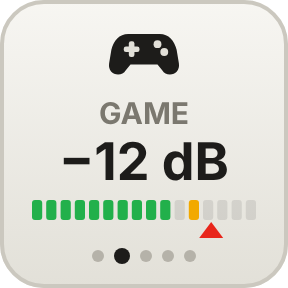 | **Track Switcher** key and knob | **Knob:** turn picks the next or previous input, press mutes it. **Key:** tap moves to the next input, hold mutes it. Dots show the position. | *Inputs to cycle through*: tick the ones you need, none ticked means all. *Look*: bar or VU. |
| 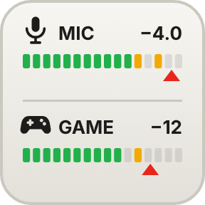 | **Duo Meter** key | Two inputs on one key with live meters. Tap mutes the top one, hold mutes the bottom one. A red **M** marks a muted input. | *Top*, *Bottom*: OBS inputs. |
| 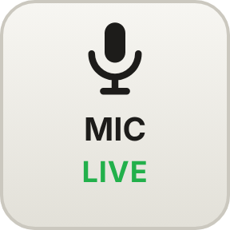 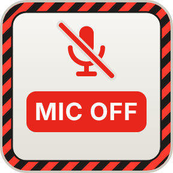 | **Mic Mute** key | Tap mutes or unmutes. Muted shows a crossed mic, MIC OFF and a red hazard frame. | *Microphone*: OBS input. |

### Output

| Key | Action | What it does |
|:---:|---|---|
| 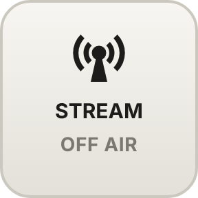 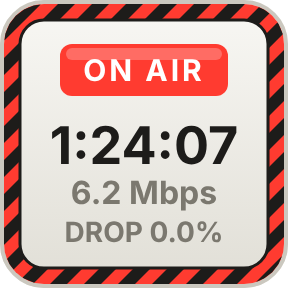 | **Stream** | Tap goes live. While live it shows the time, bitrate and dropped frames. A tap while live only says HOLD TO STOP; a hold stops the stream. |
| 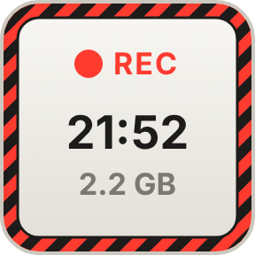 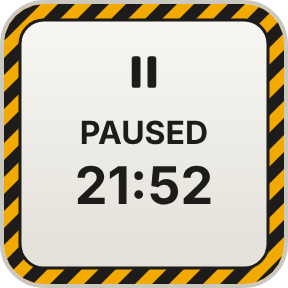 | **Record** | Tap starts, the next taps pause and resume. Hold stops. Shows the time and file size, with a yellow frame while paused. |
| 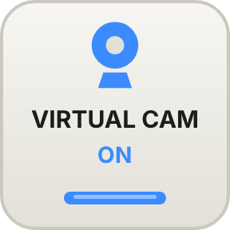 | **Virtual Camera** | Tap starts or stops the OBS virtual camera. On: the icon breathes blue. Off: the icon is crossed out. |
|  | **Replay Buffer** | Tap saves a replay (or starts the buffer when it is off). Hold stops the buffer. Shows OFF IN OBS when the replay buffer is disabled in OBS. |
|  | **Screenshot** | Tap saves a PNG of the program scene to the OBS recording folder as `Screenshot YYYY-MM-DD HH-MM-SS.png`. |

### Scenes and sources

| Key | Action | What it does | Settings |
|:---:|---|---|---|
| 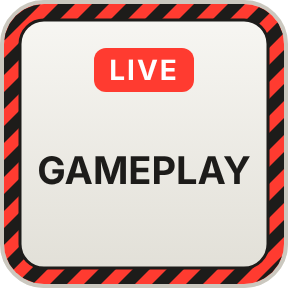 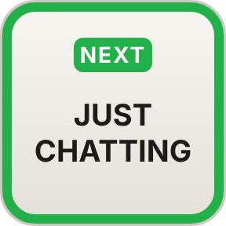 | **Scene** | Tap switches to the scene. In Studio Mode the first tap puts it in preview (green frame, NEXT), the next tap sends it on air (red frame, LIVE). Hold cuts straight to air. With extra scenes a tap moves to the next one and dots show which is selected. | *Scene*, plus up to 3 *More scenes*. |
| 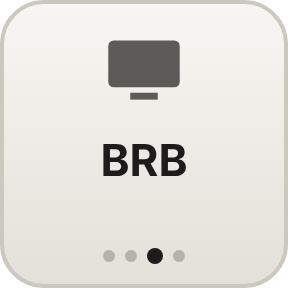 | **Scene Switcher** key and knob | **Knob:** turn picks a scene, press puts it on air. **Key:** shows the picked scene, tap puts it on air, hold cuts. All Scene Switchers share one selection, so a knob and a key work together. | *Scenes to cycle through*: none ticked means all. |
| 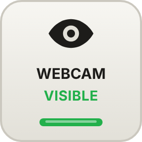 | **Source Visibility** | Tap shows or hides a source in a scene. Hidden: crossed-out eye. | *Scene*, *Source*. |
| 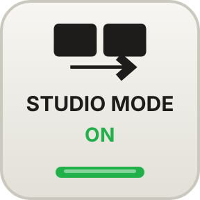 | **Studio Mode** | Tap turns Studio Mode on or off. Scene keys then show LIVE and NEXT. | |
| 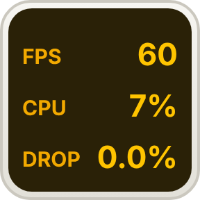 | **Stats** | OBS frame rate, CPU use and dropped frames, updated every 2 seconds. | |

## Key states

| Look | Meaning |
|---|---|
| Red and black hazard frame | On air: streaming, recording, live scene, mic off |
| Yellow and black hazard frame | Recording paused, stream starting or reconnecting |
| Green frame, NEXT | Scene waiting in preview (Studio Mode) |
| Grey dashed frame, OBS OFFLINE | OBS is closed or the connection failed; retrying every 3 s |
| Highlighted row or key | Its knob is turning right now |
| Red **M** in Duo, MUTED in Track | Input is muted |
| Blue breathing icon | Virtual camera is on; crossed out when off |

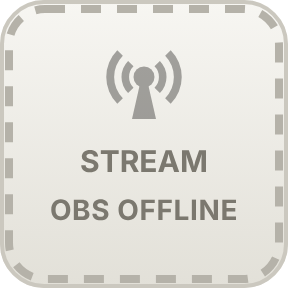

## Presets

Three ready layouts for the AKP03E: 6 keys, a big knob on the left and two small knobs. Drag the actions onto the device as listed and set them up. Input and scene names are examples; pick your own from the lists.

### 1. Gaming stream

For streaming games: everything about the stream on the top row, sound on the knobs.

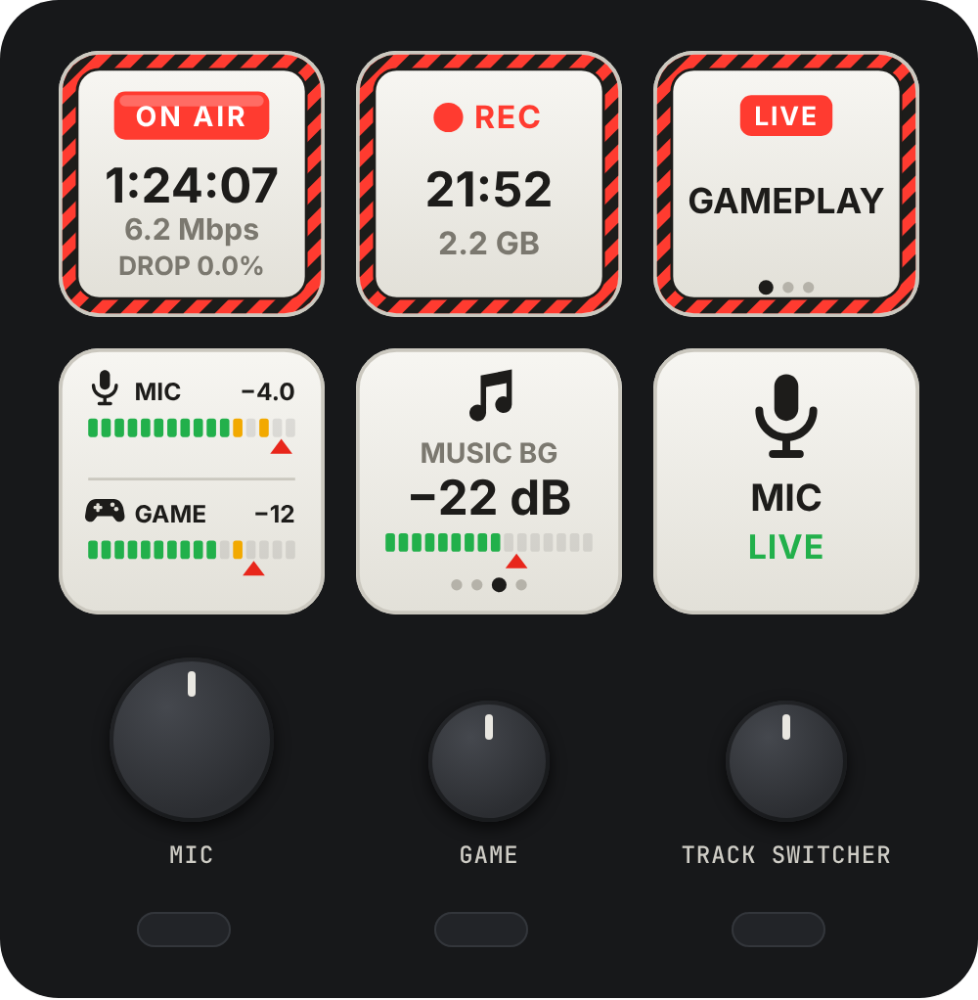

| Place | Action | Settings |
|---|---|---|
| Key 1 | Stream | |
| Key 2 | Record | |
| Key 3 | Scene | *Scene*: Gameplay, *More scenes*: Just Chatting, BRB |
| Key 4 | Duo Meter | *Top*: Mic, *Bottom*: Game |
| Key 5 | Track Volume | *Audio input*: Follow Track Switcher |
| Key 6 | Mic Mute | *Microphone*: Mic |
| Big knob | Track Volume | *Audio input*: Mic, *Knob step*: 1 dB |
| Knob 2 | Track Volume | *Audio input*: Game, *Knob step*: 2 dB |
| Knob 3 | Track Switcher | *Inputs*: Music BG, Donat Alert, Discord, Desktop Audio |

How it plays: turn the big knob for the mic and the second one for the game; the Duo key lights the row you touch. The third knob picks any other input, and key 5 follows it, so you see its level and volume. Press the knob to mute it. Tap key 3 to step through your three scenes.

### 2. Podcast / Just Chatting

For talk streams and recordings where voices matter most: two VU meters and a mic mute in easy reach.

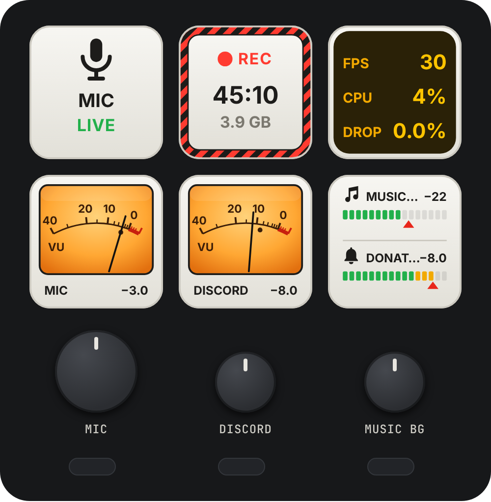

| Place | Action | Settings |
|---|---|---|
| Key 1 | Mic Mute | *Microphone*: Mic |
| Key 2 | Record | |
| Key 3 | Stats | |
| Key 4 | Track Volume | *Audio input*: Mic, *Look*: Analog VU meter |
| Key 5 | Track Volume | *Audio input*: Discord, *Look*: Analog VU meter |
| Key 6 | Duo Meter | *Top*: Music BG, *Bottom*: Donat Alert |
| Big knob | Track Volume | *Audio input*: Mic, *Knob step*: 1 dB |
| Knob 2 | Track Volume | *Audio input*: Discord, *Knob step*: 1 dB |
| Knob 3 | Track Volume | *Audio input*: Music BG, *Knob step*: 3 dB |

How it plays: keep the needles of both voices around 0 VU with the first two knobs and ride the music under the voices with the third. Stats warns you about dropped frames before the audience does.

### 3. Scene director

For shows with several cameras or screens, run in Studio Mode: prepare the next scene, then send it on air.

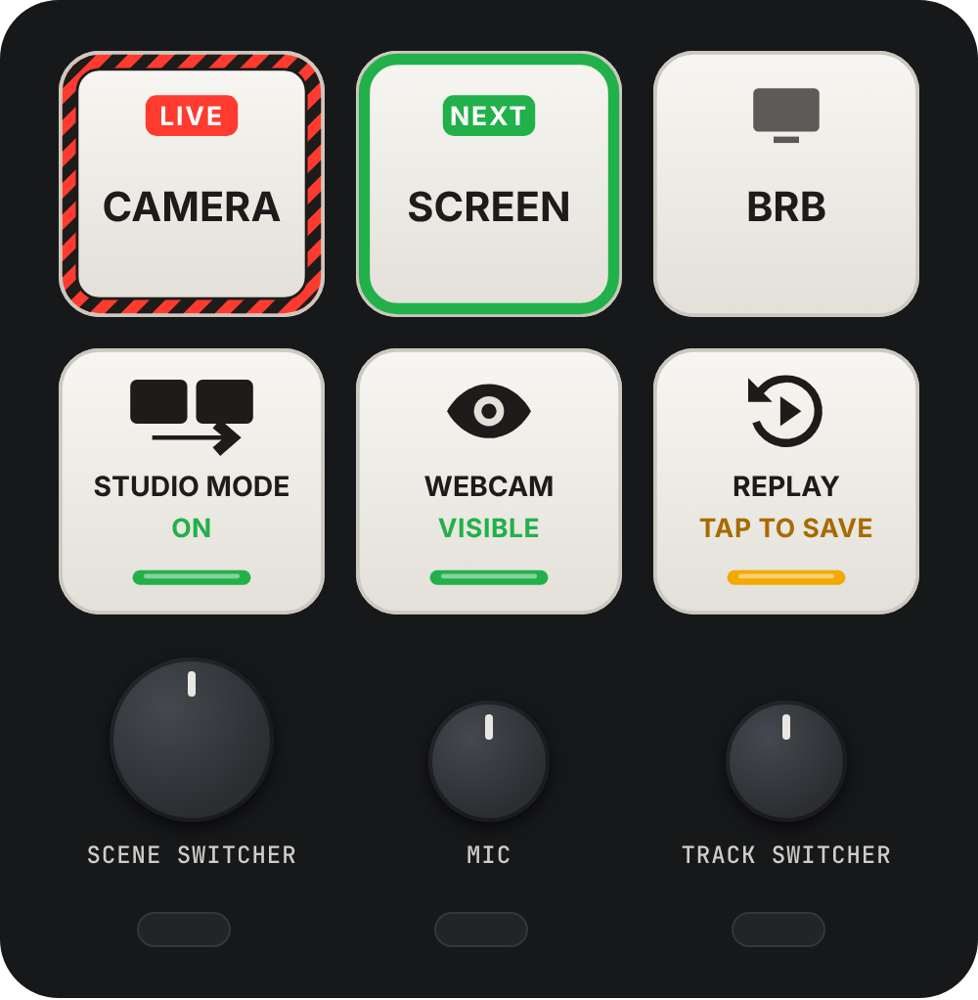

| Place | Action | Settings |
|---|---|---|
| Key 1 | Scene | *Scene*: Camera |
| Key 2 | Scene | *Scene*: Screen |
| Key 3 | Scene | *Scene*: BRB |
| Key 4 | Studio Mode | |
| Key 5 | Source Visibility | *Scene*: Screen, *Source*: Webcam |
| Key 6 | Replay Buffer | |
| Big knob | Scene Switcher | *Scenes*: none ticked (all) |
| Knob 2 | Track Volume | *Audio input*: Mic |
| Knob 3 | Track Switcher | *Inputs*: none ticked (all) |

How it plays: with Studio Mode on, tap a scene key once to load it in preview (green NEXT), and tap again to put it on air (red LIVE). Or turn the big knob to any scene and press it to go live. Key 5 hides the webcam overlay on the screen scene, and key 6 saves the last moments as a replay.

## Troubleshooting

- **Keys show OBS OFFLINE**: OBS is not running, or its WebSocket server is off. Start OBS and check [Connect to OBS](#connect-to-obs).
- **Wrong password**: the settings panel says so. Copy it again from Show Connect Info. If you turn authentication off in OBS, leave the password empty.
- **Replay Buffer says OFF IN OBS**: enable it in OBS **Settings > Output > Replay Buffer**.
- **An input is missing**: only inputs with audio are listed. Inputs added in OBS show up on their own.
- **The VU needle barely moves**: the meter is calibrated so that normal speech sits around 0 VU. Very quiet sources stay on the left; raise their gain in OBS.
- **A setting shows "(not in OBS)"**: the input or scene was renamed or deleted in OBS. Pick it again in the settings.
- The plugin writes a log to `com.diy.obs.sdPlugin/plugin/log/plugin.log`.

## Requirements

- Windows 10 or 11, Stream Dock 3.10 or newer
- OBS Studio 28 or newer (obs-websocket 5 built in)

---

© 2026 [cherry-terry](https://github.com/cherry-terry)
